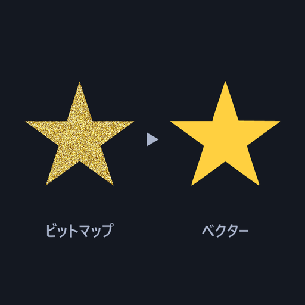

# SVG_TRACE

画像ファイルや別レイヤーの絵をトレースしてSVGに変換し、その結果を表示するカスタムオブジェクトです。
スクリプトモジュールと汎用プラグインを組にして動きます。
白黒の二値か、2 ~ 16 色のカラーでトレースできます。
トレースしたSVGは、オブジェクトメニューからSVG_Hのオブジェクトとして取り込み、線や塗りを編集できます。
「自動書き出し」をONにすれば、ファイルにも書き出します。

- **バージョン:** v0.2.0
- **作者:** by HexBrowns
- **必要環境:** AviUtl2 **2.1.10** 以上

## インストール

1. [Releases](https://github.com/HexBrowns/svg_trace/releases) から `HexBrowns.svg_trace-v0.2.0.au2pkg.zip` をダウンロードし、AviUtl2のプレビューへドラッグ&ドロップする。
   手で置く場合は、中の `Plugin` フォルダと `Script` フォルダを、AviUtl2のデータフォルダへコピーする。
   下の表の 3 つが置かれます。
2. AviUtl2を起動する。
3. オブジェクトの追加の HexScript から「SVG_TRACE」を置く。

v0.1.3 まではzipを展開して置く形でした。上書きで入れ替えて構いません。

| パス | 内容 | 必須か |
|---|---|---|
| `Script\svg_trace\SVG_TRACE.obj2` | カスタムオブジェクト本体 | 必須 |
| `Script\svg_trace\svg_trace.mod2` | トレースとラスタライズを行うモジュール | 必須 |
| `Plugin\svg_trace\svg_trace.aux2` | SVGの書き出し先の切り替えと、「SVG_Hへ送る」「最新SVGを確認書き出し」メニュー | 書き出し先をプロジェクトの隣にするとき・SVG_Hへ送るときに必要 |

「SVG_Hへ送る」を使うには、SVG_Hの `Plugin\svg_h\svg_h.aux2` も入っている必要があります。
SVG_Hは [HexBrowns/svg_hのReleases](https://github.com/HexBrowns/svg_h/releases) から入れられます。

`svg_trace.mod2` が読み込めないときや、トレースに失敗したときは、何も表示されません。
理由はログ `Log\aviutl2_*.log` に、`[SVG_TRACE]` で始まる警告として原因ごとに 1 回だけ出ます。

## 使い方

### 画像ファイルをトレースする

1. 「SVG_TRACE」オブジェクトを置く。
2. **入力** をファイルのまま、**画像ファイル** でトレースしたい画像を選ぶ。
3. **モード** を選ぶ。二値は黒いインクだけ、カラーは色ごとの面になる。
4. 二値なら **二値閾値**、カラーなら **色数** で見え方を整える。細かいゴミが多ければ **スペックル除去** を上げる。

### 別レイヤーの絵をトレースする

1. **入力** をレイヤーにする。
2. **レイヤー位置** と **レイヤー** で読み込むレイヤーを決める。初期値は相対指定・1 で、SVG_TRACEの 1 つ下のレイヤーを読む。
3. モードなどは上と同じ。

読み込んだレイヤーは、そのまま画面にも描かれます。

下のレイヤーの絵が変わらない間はトレースし直しません。
動画や動くオブジェクトを読むと、絵が変わるフレームごとにトレースし直すので重くなります。

### SVG_H で編集する

1. トレースした後、タイムラインのSVG_TRACEのオブジェクトを右クリックし、「SVG_TRACE」→「SVG_Hへ送る」を選ぶ。
2. そのオブジェクトのトレース結果を読み込んだSVG_Hオブジェクトが、マウスのあるレイヤー・フレームに作られる。

送るのは、**右クリックしたオブジェクトのトレース結果**です。
どのオブジェクトかは次の順で決めます。

1. マウスの位置にあるオブジェクトが選択中なら、それ。
2. 無ければ、フォーカス中のオブジェクト。
3. それも無く、選択が 1 つだけなら、それ。

そのオブジェクトの結果が見つからないときは、**何も送らずに理由をメッセージで出します**。
AviUtl2を起動してからまだプレビューに表示していない、SVG_TRACE以外を右クリックした、トレースに失敗している、などのときです。
SVG_TRACEのオブジェクトをプレビューに表示してから、もう一度選んでください。

SVG_Hが読むのは、送る結果を書き出し先のフォルダへ `handoff_{時刻}.svg` として書いたファイルです。
後でトレースし直しても、作ったSVG_Hの中身は変わりません。
自動書き出しがOFFのままでも使えます。

## パラメータ

### 入力の設定

| 項目 | 範囲 / 選択肢 | 初期値 | 説明 |
|---|---|---|---|
| 入力 | ファイル / レイヤー | ファイル | トレースする元 |
| 画像ファイル | ファイル選択 | （空） | 入力がファイルのときにトレースする画像。空なら何も表示しない |
| レイヤー位置 | 絶対指定 / 相対指定 | 相対指定 | 入力がレイヤーのときの、「レイヤー」の数え方。絶対指定はレイヤー番号そのもの、相対指定はSVG_TRACEのレイヤーからの差（プラスで下のレイヤー） |
| レイヤー | -100 ~ 100 | 1 | 読み込むレイヤー。自分自身のレイヤーや 0 以下の番号になるときは何も表示しない |

### トレース

| 項目 | 範囲 / 選択肢 | 初期値 | 説明 |
|---|---|---|---|
| モード | 二値 / カラー | 二値 | 二値は明るさで白黒に分け、黒い部分だけをインクとして残す（白い部分は透明）。カラーは色ごとの面に分ける |
| 色数 | 2 ~ 16 | 8 | カラーのときの色の細かさの目安。多いほど色の段階が細かくなる。二値では使わない |
| 二値閾値 | 0 ~ 255 | 128 | 二値のとき、明るさがこの値より暗い部分をインクにする。上げるほどインクが増える。カラーでは使わない |
| スペックル除去 | 0 ~ 64 px | 4 | この大きさより小さい点やかけらを捨てる |
| 角閾値 | 0 ~ 180 度 | 60 | 輪郭の曲がり方を角として残すかの基準の角度 |

### 書き出し

| 項目 | 範囲 | 初期値 | 説明 |
|---|---|---|---|
| 出力SVG | ファイル選択 | （空） | 自動書き出しのとき、書き出し先フォルダとは別にもう 1 本書くファイル。空なら書かない |
| 自動書き出し | ON / OFF | OFF | ONのとき、トレースするたびに書き出し先フォルダへSVGを書き、「出力SVG」も上書きする。OFFならファイルを何も作らない |

## SVG の書き出し先

**自動書き出しがOFFのときは、ファイルを何も作りません。**
v0.1.4 までが書いた `Plugin\svg_trace\latest_trace.svg` と `Plugin\svg_trace\traces\{番号}.svg` は、AviUtl2の起動時に `svg_trace.aux2` が片付けます。

ONにすると、トレースするたびに次のフォルダへ書き出します。
OFFからONにしたときは、その場でトレースし直して書きます。

| 状態 | フォルダ |
|---|---|
| プロジェクトを保存済み（開いた・保存したとき） | プロジェクトと同じフォルダの `SVG_export\` |
| 未保存 | `Plugin\svg_trace\export\` |

| 入力 | ファイル名 |
|---|---|
| ファイル | `{画像名}_{000 からの連番}.svg`。999 の次は 1000 |
| レイヤー | `layer{レイヤー番号}_{フレーム番号}.svg`。フレーム番号はトレースし直したフレーム |

- ファイル入力の連番は、**スライダーをドラッグしている間は同じ番号を上書き**し、手を止めてから変えると次の番号になります。
  前の番号と同じ内容になったときは書きません
- レイヤー入力は、下のレイヤーの絵が変わってトレースし直したフレームだけ書き出します。
  絵が変わらない間のフレームのファイルはできません
- どちらの場合も、同じフォルダの `latest.svg` が最新の結果で上書きされます。**出力SVG** にファイルを選んでいれば、そこにも同じ結果を上書きします。
  どれも、前に書いたものと同じ内容なら書き直しません
- 書き出しに失敗しても表示は続け、ログに理由を 1 回だけ出します

エクスポートメニューの「SVG_TRACE」→「最新SVGを確認書き出し」を選ぶと、最後にトレースした結果を、
上の書き出し先のフォルダに `trace_{時刻}.svg` として書き出します。
自動書き出しがOFFでも使えます。

書き出し先のフォルダは `svg_trace.aux2` が決めます。「SVG_Hへ送る」「最新SVGを確認書き出し」で書くフォルダも同じです。
入っていないときは、前回の書き出し先か `Plugin\svg_trace\export\` のままになります。

## 重さの目安

トレースは、プレビューの描画の中で行います。**トレースし終わるまでAviUtl2は止まります。**
設定を変える・スライダーを 1 段動かすたびにトレースし直します。
一度トレースした結果は持っておくので、同じ設定・同じ絵のうちは再生しても軽く描けます。
FHDの結果で 1 フレーム 0.1 ms ほどです。初めて描くときだけ 15 ms ほどかかります。

1 回のトレースに掛かる時間です。絵の細かさでほとんど決まり、色数ではあまり変わりません。

| 絵 | 大きさ | 二値 | カラー（2〜16 色） |
|---|---|---|---|
| ロゴ・イラスト（色の面が少ない） | 512² | 10 ms 未満 | 20 ms ほど |
| 〃 | FHD | 30〜50 ms | 110〜170 ms |
| 〃 | 2048² / 4K（長辺 2048 に縮めてから） | 70〜240 ms | 250〜470 ms |
| 写真のような細かい絵（最悪の場合: 画素ごとに色が違う） | 512² | 60〜80 ms | 0.7〜1.4 秒 |
| 〃 | FHD | **失敗する** | **17〜24 秒** |

- **細かい絵は、先に小さくしてから調整する**のが速く済みます。
  細かい絵をFHDのまま扱うと、スライダーの 1 段ごとに数秒〜数十秒止まります
- 二値はカラーより速く済みます
- **二値で細かすぎる絵は失敗します。** ログに理由が出ます。
  スペックル除去を上げるか、二値閾値を変えるか、カラーにしてください
- ファイル入力では、読んだ画像を持っておくので、スライダーを動かすたびに画像を読み直しません
- レイヤー入力では、毎フレーム、下のレイヤーの絵を読んで変わったかを確かめます。FHDで 1 フレーム 0.3 ms ほどです

## 注意

- **トレースは重い処理です。** レイヤー入力で動画や動くオブジェクトを読むと、絵が変わるフレームごとにトレースし直します。
  自動書き出しをONにしていると、そのたびに `layer…_{フレーム}.svg` が書き出されます
- ファイル入力では、同じパスの画像ファイルを上書きして差し替えるとトレースし直します
- 長辺が 2048 ピクセルを超える画像は、長辺 2048 に縮めてからトレースします。表示される大きさも縮めた後の大きさになります
- 1 億画素を超える画像ファイルは読みません。何も表示せず、ログに理由を出します。先に縮めてから使ってください
- **同時に見えているSVG_TRACEは 32 個まで**にしてください。
  超えると、毎フレームトレースし直したり描き直したりして重くなります。そのときはログに 1 回だけ警告が出ます
- レイヤー入力では、読み込むレイヤーのフィルタ効果は掛かっていない状態の絵をトレースします
- カラーでは、半透明の部分は色をそのままにして不透明として扱います
- SVG_TRACEを 2 つ以上置いても、それぞれが自分のトレース結果を表示します。「SVG_Hへ送る」は右クリックした方の結果を送ります
